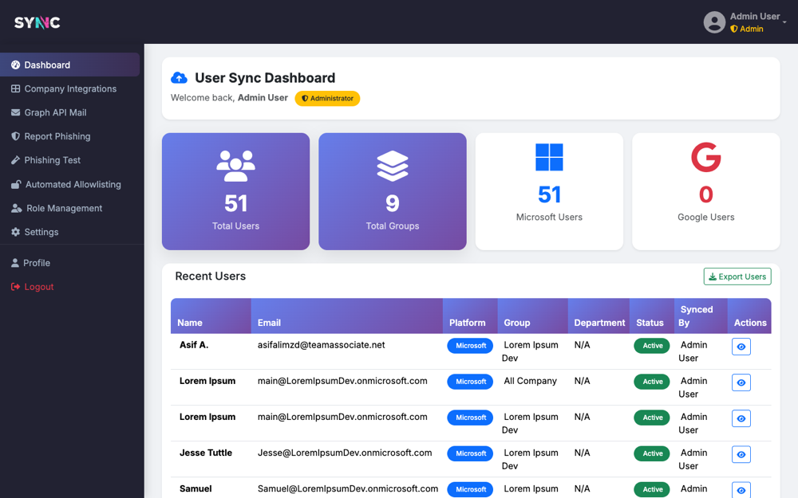
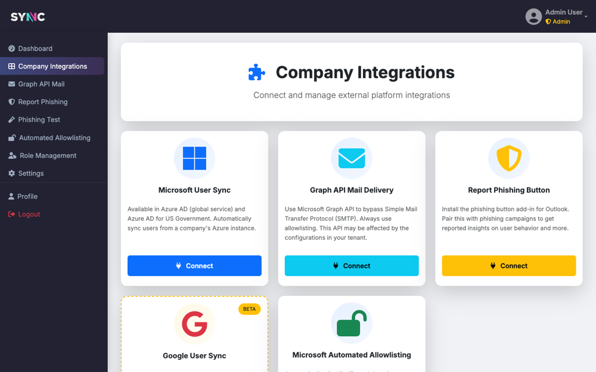
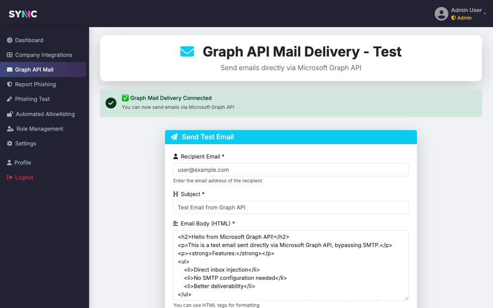
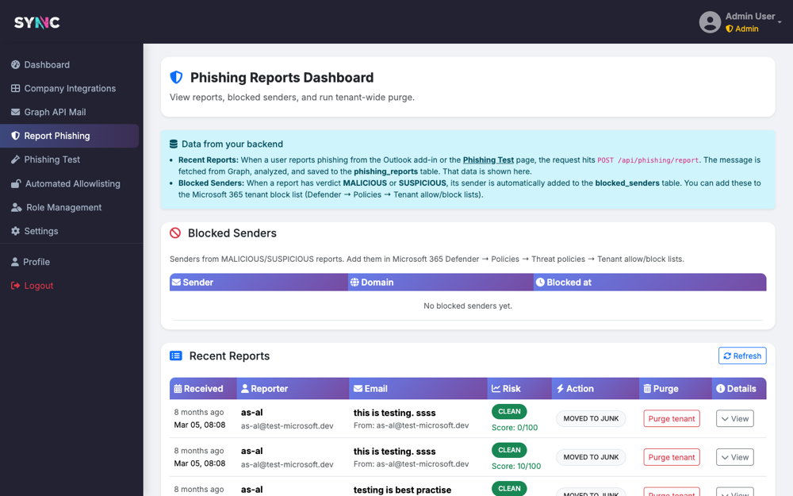
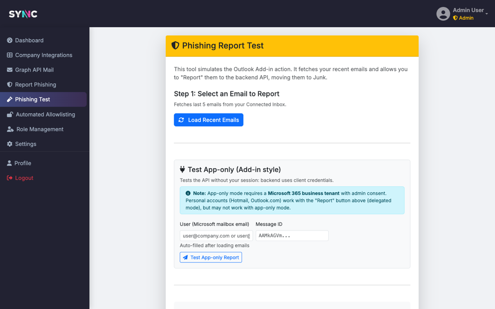
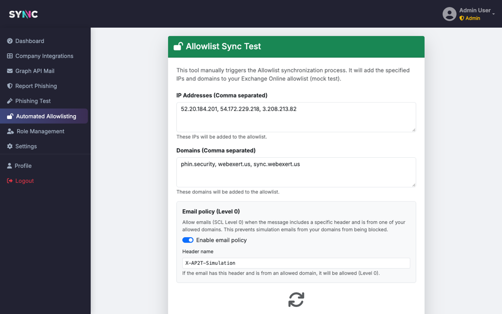
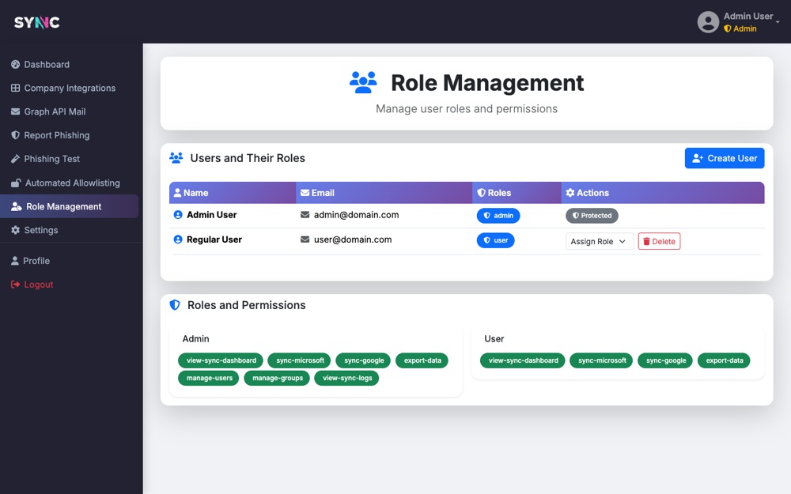
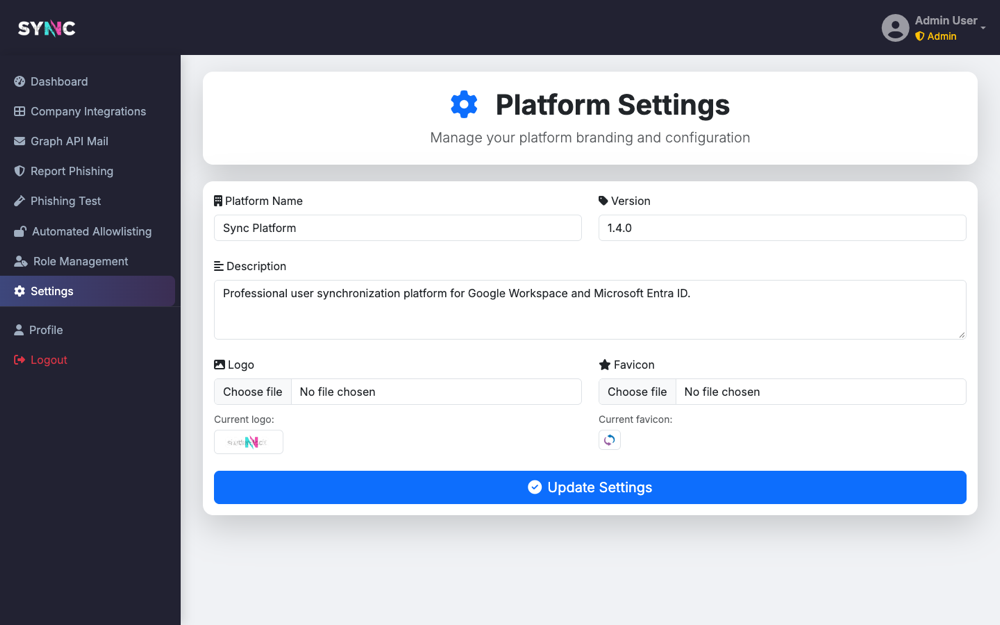

# Microsoft & Google Sync Platform

Laravel platform for **directory user sync** and Microsoft 365 security integrations — Azure AD / Google Workspace sync, Graph mail delivery, Outlook phishing reporting, and automated allowlisting.

> Built by **Muhammad Usman** (Laravel / PHP) — OAuth flows, Graph/Exchange integrations, roles & permissions, and admin UI.

---

## Features

### Sync dashboard
- Synced users & groups overview (Microsoft / Google counts)
- Recent users list with detail pages
- Recent groups & sync activity
- Export users / groups (JSON)

### Company integrations hub
- **Microsoft User Sync** — Azure AD (global / US Gov) user sync via OAuth
- **Google User Sync** (BETA) — Google Workspace directory sync
- **Graph API Mail Delivery** — send mail via Microsoft Graph (bypass SMTP)
- **Report Phishing** — Outlook add-in + report dashboard / purge workflow
- **Phishing Test** — test tooling for phishing report flow
- **Microsoft Automated Allowlisting** — Exchange Online IP/domain allowlist sync

### Access control
- Spatie roles & permissions
- Admin role management (assign / revoke roles, manage users)
- Settings panel for platform configuration
- Profile management

---

## Tech stack

| Layer | Technology |
|-------|------------|
| Backend | **PHP 8.2+**, **Laravel 12** |
| Auth | Laravel Breeze / session auth, **Spatie Permission** |
| OAuth | **Laravel Socialite** + Microsoft & Google providers |
| Integrations | Microsoft Graph, Exchange Online, Google Admin directory |
| UI | Blade, Tailwind CSS, Vite |
| Database | MySQL / SQLite (local) |

---

## Screenshots

### Sync dashboard



### Company integrations



### Graph API mail



### Phishing reports



### Phishing test



### Automated allowlisting



### Role management



### Settings



---

## Local setup

```bash
composer install
cp .env.example .env
php artisan key:generate
# configure DB + Microsoft/Google OAuth client IDs/secrets in .env
php artisan migrate --seed
npm install && npm run build
php artisan serve
```

Seeded admin (local only): see `database/seeders/AdminUserSeeder.php`.

OAuth / Azure permission notes: `OAUTH_SETUP.md`, `INTEGRATIONS_README.md`, `AUTHORIZATION_FIX.md`.

---

## Author

**Muhammad Usman** — Full-Stack Developer (Laravel / PHP)  
[GitHub](https://github.com/usman-wurfel) · [LinkedIn](https://www.linkedin.com/in/muhammad-usman-ali-311418221)
